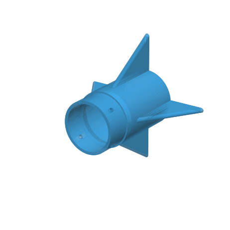
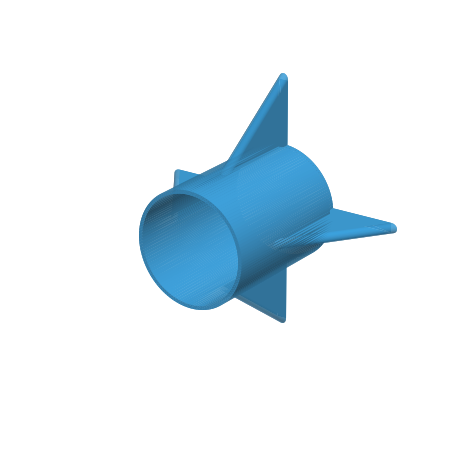
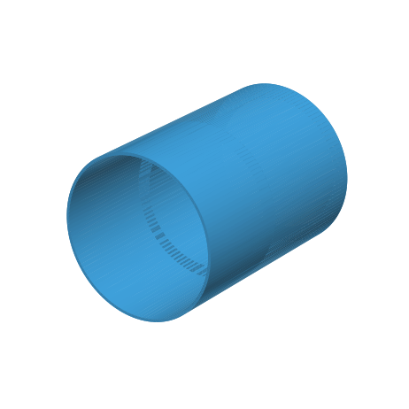
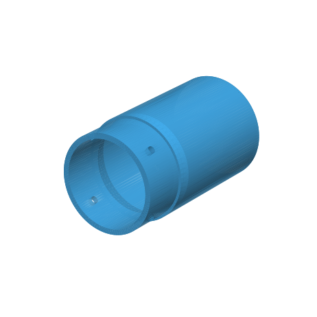
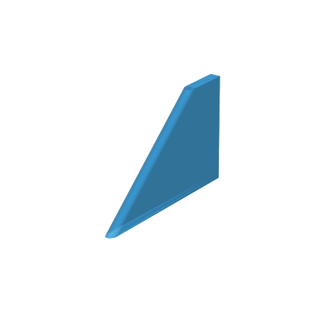
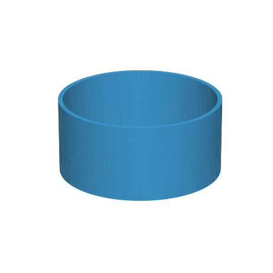
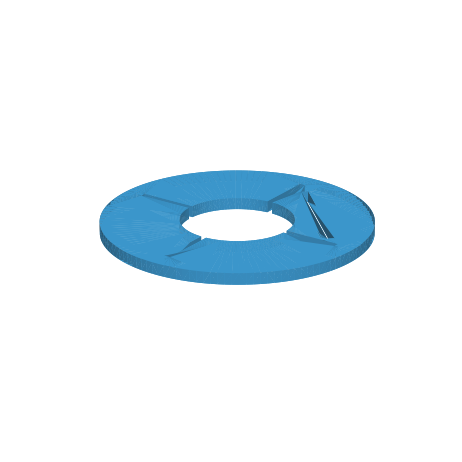

# Yellow Jacket

Mission Launch Rocketry's two-stage high-power rocket: a 58 mm, 1.47 m stack with an H219T booster and an H100W
sustainer that lights in flight. **Status (Nov 2026): design rework in progress.**

| | |
|---|---|
| Diameter / length | 58 mm (2.15" tube) / 1,468 mm |
| Liftoff mass | 1,885 g |
| Booster | AeroTech H219T (38 mm, 235 Ns) |
| Sustainer | AeroTech H100W DMS (38 mm, 228 Ns), lit by timer at launch + 4 s |
| Simulated apogee | ~5,100 ft (OpenRocket, 2 m/s wind) |
| Recovery | dual deploy: 18" drogue at apogee, 36" main at 1,500 ft; 24" booster chute |

## Files

| Folder | What's in it |
|---|---|
| [`openrocket/yellow-jacket.ork`](openrocket/yellow-jacket.ork) | The OpenRocket design. One file; its history is in git (`git log --follow`). |
| [`cad/onshape/`](cad/onshape) | STEP snapshots of every part in the club's Onshape folder, with previews and [`parts.md`](cad/onshape/parts.md) (sizes, volumes, links back to Onshape). [`manifest.json`](cad/onshape/manifest.json) records where and when each was exported. |
| [`analysis/`](analysis) | Reviews and sims. Start with [`baseline-2026-11-13.md`](analysis/baseline-2026-11-13.md). |

**Heads-up:** the saved .ork has the booster stage switched off in its default flight configuration, so its stored
simulation flies the sustainer alone. Turn the 1st Stage back on (Flight configurations > the stage checkboxes) to fly
both stages.

## Parts in Onshape

| | | |
|---|---|---|
|  |  |  |
| **Upper Stage (Real)** fin can, 57.2 mm body, 4 fins 75 × 35 mm. [Onshape](https://cad.onshape.com/documents/9326782fdec3a25107ad14a0/w/d80940868c25c5cec2edee74) | **Lower Stage** fin can, 4 fins 75 × 32 mm. [Onshape](https://cad.onshape.com/documents/3a234e593d42b7f22c6d8ed4/w/d731ea35abd4a87237f4b7bf) | **Lower Stage** 53 mm tube, 75 mm long |
|  |  |  |
| **Upper Stage** (Feb 20 draft) tube, 100 mm. [Onshape](https://cad.onshape.com/documents/4ca3fee37e2012109908dee1/w/6fbd0f4a22402b0e0d50d236) | **Upper Stage** (Feb 20 draft) separate fins, 50 × 32 mm, 3 mm thick | **Nose cone** ring, 54.2 mm OD × 25 mm (newest, Nov 7). [Onshape](https://cad.onshape.com/documents/403251906b89431bd729f945/w/6e691212f36793b7e3c31172) |
|  |  | |
| **Fin Jig**, 138 mm. [Onshape](https://cad.onshape.com/documents/d694864bc20f59b94844fe15/w/60798a3776a57415a46224ca) | **blast_absorber**, 38 mm disc, 3 mm. [Onshape](https://cad.onshape.com/documents/1e779da9001577f724ec5ac9/w/9c8694aa7aef5c261e976bf7) | |

The CAD and the .ork have drifted apart: the CAD booster fins are 75 × 32 mm where the .ork has 60 × 25 mm, which
changes the liftoff margin from 0.81 to 1.82 calibers. See the [baseline review](analysis/baseline-2026-11-13.md).

## Open items for the rework

- Fin sizes: make the .ork and the CAD agree, then size for at least 1 caliber off the rail in the wind we fly in.
- Sustainer fins: 0.80 cal at ignition in the .ork, 0.67 with the CAD fin can.
- Booster chute: deploy at booster apogee, not at separation (69.5 m/s).
- Main deploy altitude: 1,500 ft drifts about 600 m in a 4 m/s wind.
- Model gaps: booster fin mass, av-bay window mass, interstage coupler.

## History

| When | Change |
|---|---|
| Jan to Mar 2026 | First design, saved as `mission_rocky.ork`: H283ST booster, H100W sustainer, ~1,509 m |
| Aug 22, 2026 | Booster motor changed to the H219T |
| Nov 13, 2026 | Heavier chutes, 75 g booster mass; booster stage left off in the default config |
| Nov 14, 2026 | Repo reorganized; CAD exported from Onshape; baseline review |
